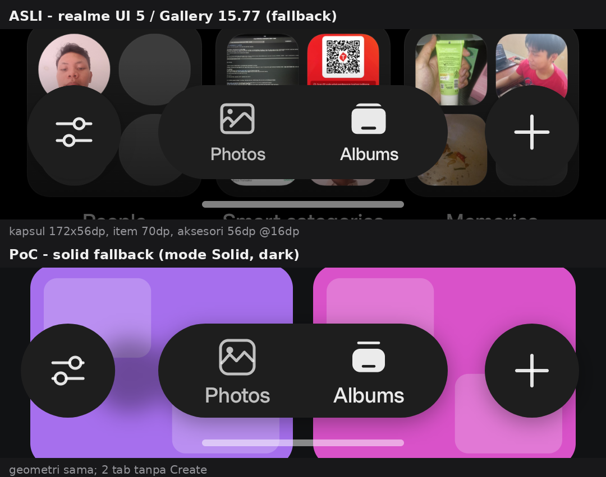
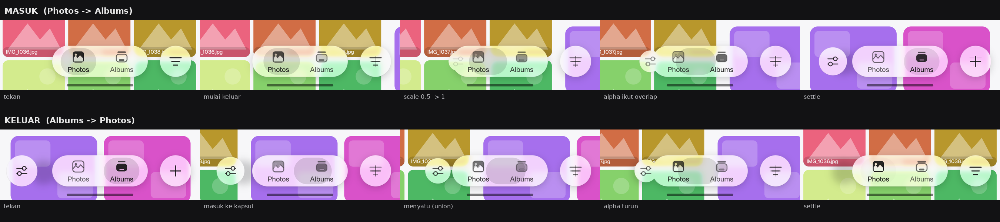
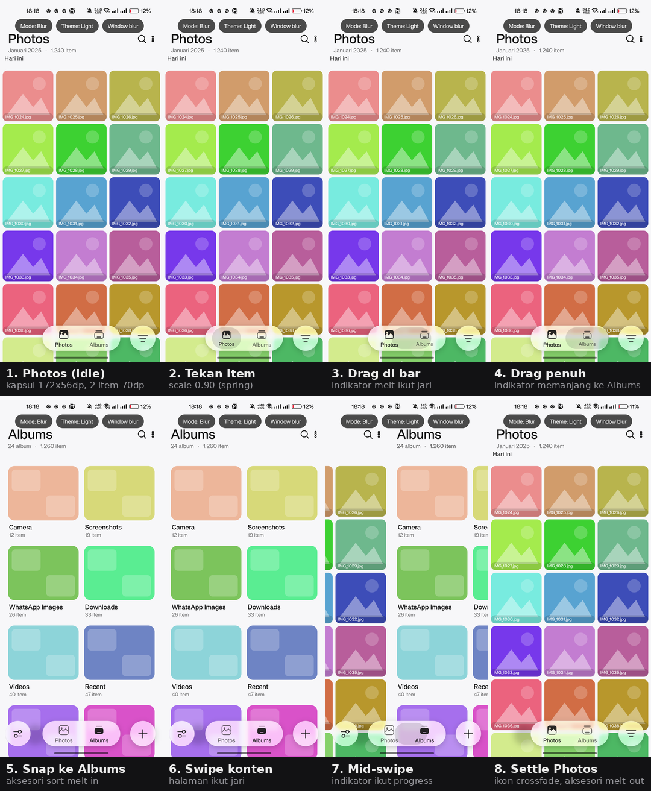

# BlurNav PoC — bottom navigation ala ColorOS Gallery 17.10.62

PoC Android tanpa dependency (~33 KB) yang mereplikasi **bentuk** dan **efek** bottom navigation Gallery ColorOS 17.10.62:

- **bentuk asli**: 2 tab (Photos, Albums) — **tanpa Create**
- kapsul 172×56 dp di tengah, item 70 dp, aksesori 56 dp di tepi kiri/kanan
- blur backdrop + tint COUI, fallback solid `couiColorBar`
- gesture + animasi spring (melt indicator, press scale/deform COUI, squish, pager)

Diuji di **realme RMX3630, Android 14 (API 34), realme UI 5.0, 1080×2400 @480dpi** — device tanpa OPlusView 40.2, jadi Gallery aslinya jatuh ke fallback solid. PoC ini menampilkan versi blur-nya, plus interaksi.



## Bentuk: kenapa 2 tab, bukan 3

**terlihat** — `res/menu/` punya dua varian:

| Menu | Isi |
|---|---|
| `main_tab_bottom_floating_nav_menu_two` | Photos, Albums |
| `main_tab_bottom_floating_nav_menu_three` | Photos, Albums, **Create** |

`TabFragment.inflateMenu(J3() ? three : two)` dengan gate:

```java
// qa90
pab.c(6, "feature_is_creation_tab_enabled", false)   // default false
// ra90
pab.b("is_region_cn", false, false)

J3(): jika feature flag mati -> false (2 tab)
      jika region CN       -> pab.c(4, "show_creation_tab", true)
      selain itu           -> true (3 tab)
```

Jadi tab Create hanya muncul kalau cloud config `feature_is_creation_tab_enabled` dinyalakan. Default & kondisi device ini: **2 tab**.

### Geometri (dari resource COUI + pengukuran device)

| Elemen | Nilai | Sumber |
|---|---|---|
| Tinggi kapsul/menu | 56 dp | `coui_bottom_floating_navigation_bar_height` |
| Tinggi item | 48 dp | `..._item_height` |
| Lebar maks item | 70 dp | `..._item_max_width` |
| Padding dalam kapsul | 12 dp | `..._item_padding` |
| Jarak antar item | 8 dp | `..._item_space` |
| Padding horizontal layar | 16 dp | `..._padding_horizontal` |
| Tinggi minimum bar | 88 dp | `..._min_height_without_padding_vertical` |
| Jarak ke nav bar sistem | 8 dp | `..._menu_to_screen_navi_distance` |
| Diameter aksesori | 56 dp | memakai `..._navigation_bar_height` |

Lebar menu (`BaseBottomFloatingMenuView.onMeasure`):

```
w = min(available, 2*12 + 8*(n-1) + 70*n)
n=2 -> 172 dp ; n=3 -> 250 dp
```

Di layar kecil (`COUIResponsiveUtils.isSmallScreen`), aksesori diletakkan di tepi layar (16 dp) dan kapsul tetap di tengah — persis seperti yang terukur di device:

```
kapsul   : x 283..797 px  = 171 dp  (172 dp)
tinggi   : y 2160..2327   = 56 dp
aksesori : Ø 171 px = 57 dp, margin 16 dp dari tepi
bar      : 88 dp, bottom margin 8 dp
```

### Ikon & aksesori

| Tab | Kiri | Kanan |
|---|---|---|
| Photos | – (tersembunyi) | filter (3 garis mengecil) |
| Albums | sort (2 slider) | add album (`+`) |

Item aktif memakai ikon **filled**, item pasif **outline** — sama seperti Gallery asli (tidak ada pil indikator saat diam).

## Efek (sama seperti APK asli)

| Elemen | Nilai |
|---|---|
| Blur backdrop | `RenderEffect` 25 px (tile `MIRROR`, seperti COUI). Konten di belakang bar direkam langsung ke `RenderNode` di `onDraw` bar — tanpa bitmap, di frame yang sama dengan konten |
| **Progressive blur** | mode **0** uniform, **1** 0→25 px ke bawah, **2** 25→0 px ke bawah. Tiga tingkat (0 / 10 / 25 px) ditumpuk dengan mask gradient; ketiganya memakai tint yang sama |
| Light tint | `#B3666666` COLOR_DODGE → `#99F5F5F5` LUMINOSITY |
| Dark tint | `#80666666` OVERLAY → `#B3262626` LUMINOSITY |
| Bentuk | kapsul + 2 lingkaran aksesori, radius = tinggi/2; rim 3 dp faint + garis 1 px gradient vertikal (terang di atas) yang sama untuk ketiga bentuk |
| Scrim | gradient transparan → warna latar, alpha 0.64, di dasar konten (padanan `bottomTranslucentView`); ikut ter-blur oleh bar. `--ei scrim 0` mematikan |
| Shadow | fallback `#8A000000`, 12 dp, offset 2 dp; caustic putih `#42FFFFFF`, 10.4 dp, offset 4.9 dp |
| Fallback | `couiColorBar` `#FAFAFA` / `#1E1E1E` |
| Mode | `SPLIT` (kiri blur / kanan solid), `BLUR`, `SOLID`, `Window blur` |

Blur di-clip ke **bentuk aslinya** (kapsul + lingkaran), bukan full-width — sama seperti COUI yang menerapkan material effect ke menu view dan tiap accessory view.

## Animasi (port COUI; melt aksesori masih approximation)

| Animasi | Parameter |
|---|---|
| Aksesori melt-in/out | translasi dari tepi menu (fake bounds) ke 16 dp dari layar; scale 0.5 → 1 (response **0.55**, bounce **0.35** — angka `AccessorySideExpansionController`) |
| Alpha aksesori | mengikuti *overlap ratio* dengan kapsul (bukan spring terpisah) — hilang saat menyatu, muncul saat keluar |
| Bentuk menyatu | `Path.Op.UNION` + **leher metaball**: dua kurva bezier yang menyinggung ujung kapsul dan lingkaran aksesori; leher menipis lalu putus saat celah mencapai 12 dp |
| Ikon tab | crossfade outline ↔ filled (response 0.22) + warna label di-lerp |
| Ikon aksesori kanan | crossfade filter ↔ `+` saat pindah tab |
| Indikator melt | memanjang saat drag, mengecil ke item (response 0.34) lalu memudar 120 ms setelah settle |
| Press (kapsul & tombol) | scale **0.85–0.97** (area + aspect), response 0.25; release 0.5 / bounce 0.6 |
| **Rubber (kapsul & tombol)** | `TouchMotionRubberBand`: maks **28 dp**, curve **0.05**, drag spring **0.15 / 0.15**, dead zone 5 dp |
| **Deform kapsul (172×56 dp)** | area-conserving (`scaleX·scaleY≈1`), maks **150 dp**, curve **0.55**, max scale **≈1.15×** |
| **Deform tombol (56×56 dp)** | area-conserving, max scale **≈1.20×** |
| Release jelly | response **0.45** (kapsul) / **0.42** (tombol), bounce **0.65** |
| **Light pool** | muka kaca +5.5% putih, pool gaussian radius **38 dp** di bawah jari (`0.07 × gain 1.5`), blend `PLUS` |
| Ink (ikon/label) | ikut transform penuh kapsul, sama seperti children di menu view COUI |
| Menyatu | `Path.Op.UNION` + leher bezier sebagai pengganti metaball OPlus |

Default = **port parameter COUI** dari `COUIPressAnimatorUnit` + `COUIITouchMotionUnit`
(`PressParams`, `TouchMotionTierParams`, `CommonParams`): press mengecilkan seluruh
kapsul/tombol, deform menstretch satu sumbu sambil menyusutkan sumbu lain, rubber
membatasi geseran ke 28 dp. Angka ini default di APK 17.10.62; ColorOS bisa override
per tier perangkat. Rincian ada di [jelly-spec.md](jelly-spec.md).

`--ei jelly 2` = boost 3× untuk demo, bukan nilai COUI.

### Kecepatan spring

`response` di PoC ini = **periode natural** (ω = 2π/response), sama seperti Compose
`spring(response, bounce)` / `COUISpringAnimation`. Press memakai 0.25 s (down) dan
0.5 s (release); rubber/deform memakai 0.15 s saat drag dan 0.42–0.45 s saat lepas.

`Spring.update()` juga memakai solusi analitik per frame, bukan Euler, karena Euler
eksplisit meledak untuk response 0.15 dtk di 60 fps (`dt·2ζω = 2.0`).

Knob global: `--ef speed 1.4` (mempercepat semua spring 1.4×), `--ef speed 0.7` untuk
memperlambat tanpa mengubah kode.

Semua di-drive `Choreographer` (langkah waktu dari `frameTimeNanos`) dengan model spring
yang sama seperti `COUISpringAnimation`. Melt aksesori memakai scale/translation 0.55/0.35
dan `EXPANSION_VIEW_MIN_SCALE = 0.5` dari COUI; alpha mengikuti overlap ratio.



`anim-accessory.gif` menampilkan melt-in (Photos → Albums) dan melt-out (Albums → Photos)
dalam **slow-mo 10×** (frame diambil dengan `--ef slowmo 10`; animasi aslinya ±0.4–0.6 s).

## Gesture & fluid

| Gesture | Efek |
|---|---|
| Tap item | Pilih tab; ikon filled pindah, konten slide dengan spring |
| Press | seluruh kapsul/tombol mengecil **0.85–0.97×** (area + aspect), release bounce 0.6 |
| Drag di kapsul | rubber 28 dp + deform area-conserving; indikator melt mengikuti jari, lepas → snap ke item terdekat |
| Swipe horizontal di konten | Pindah halaman; konten ikut jari, indikator bar ikut progress, settle spring 0.40/0.32 |
| Fling vertikal | Scroll grid dengan peluruhan kecepatan (`v·e^(−4t)`), pegas di batas atas/bawah; bar squish halus lalu balik (tambahan PoC, `--ei squish 0` mematikan) |
| Aksesori | Tap → toast Sort / Add album / Filter (placeholder aksi asli); drag → rubber + deform per tombol |

Indikator melt bersifat **transien**: muncul saat interaksi, memudar ~120 ms setelah settle — sehingga keadaan diam sama dengan Gallery asli. Di COUI asli efek ini bagian dari spotlight/melt-ball yang hanya hidup saat material effect aktif.

## Hasil



- `fluid.gif` — 16 frame asli (Photos → drag bar → Albums → swipe balik), 400×889
- `anim-accessory.gif` — melt-in/out aksesori (slow-mo 10×, crop nav bar)
- `shots/anim-accessory.png` — storyboard melt-in & melt-out
- `jelly.gif` — port COUI: tekan + tarik kapsul lalu lepas (slow-mo 4×, crop)
- `shots/jelly-ref-vs-loud.png` — COUI vs boost 3× pada tarikan yang sama
- `shots/jelly-hero-light.png`, `shots/jelly-hero-dark.png` — keadaan ditekan + ditarik
- `shots/jelly-sweetspot-vs-lebay.png` — perbandingan versi sebelumnya
- `jelly-lebay.gif`, `shots/jelly-lebay.png` — versi demo `--ei jelly 2` (boost 3×)
- [jelly-spec.md](jelly-spec.md) — rumus + konstanta port COUI dari Gallery 17.10.62
- `shots/nav-photos-light.png`, `shots/nav-albums-light.png` — blur, light
- `shots/nav-photos-dark.png`, `shots/nav-albums-dark.png` — blur, dark
- `shots/nav-photos-solid.png`, `shots/nav-albums-solid.png` — fallback solid terang
- `shots/nav-photos-solid-dark.png`, `shots/nav-albums-solid-dark.png` — fallback solid gelap
- `shots/compare-device-vs-poc.png` — Gallery asli (device) vs PoC, bentuk sama
- `shots/window-light.png`, `shots/window-dark.png` — window blur API 31: OFF di device ini
- `seq3/` — frame mentah untuk GIF/storyboard

Catatan: `jelly*.gif` dan hero shot lama dibuat sebelum port COUI (masih model Swell).
Angka acuan ada di [jelly-spec.md](jelly-spec.md); capture ulang menyusul.

Catatan: **semua** GIF dan screenshot di folder ini diambil sebelum perubahan backdrop
`RenderNode`, progressive blur 3 tingkat, leher metaball, stroke vertikal, dan scrim.
Perubahan itu baru dicek kompilasinya, belum dijalankan dan di-capture di device.

Catatan: `screenrecord` di device ini segfault, jadi GIF disusun dari `screencap` per fase gerakan (bukan rekaman 60 fps). Animasi aslinya tetap spring-driven via `Choreographer`.

## Window blur (API 31) — hasil

| Cek | Nilai |
|---|---|
| `settings get global disable_window_blurs` | `0` |
| `WindowManager.isCrossWindowBlurEnabled()` | `false` |
| `ro.surface_flinger.supports_background_blur` | kosong |
| `ro.hardware` | `mt6789` |

Tanpa dukungan SurfaceFlinger, `setBackgroundBlurRadius(25)` tidak menghasilkan blur; bar otomatis solid + label `window blur: OFF (hardware/OEM)`.

## Build & install

```bash
./build.sh
adb install -r build/blurnav-poc.apk
adb shell am start -n dev.iqbal.blurnavpoc/.MainActivity --ei mode 1 --ei dark 0
# mode: 0=split 1=blur 2=solid, dark: 0/1
# slow-mo untuk capture: tambah --ef slowmo 10 (1 = normal)
# jelly: default = port COUI (press 0.85-0.97, rubber 28dp, deform 150dp); --ei jelly 2 = boost 3x
# progressive: --ei prog 0 (uniform) / 1 (0->25px ke bawah) / 2 (25->0px ke bawah)
# knob tuning: --ef lean 2 (gain jelly), --ef light 3 (pool 3x)
# scrim bawah: --ei scrim 0 (mati); squish bar saat fling: --ei squish 0 (mati)
# window blur: adb shell am start -n dev.iqbal.blurnavpoc/.WindowBlurActivity --ei dark 0
```

### Build di HP (Termux)

`build.sh` juga jalan tanpa Android SDK: tool diambil dari `PATH`, `android.jar` dari
`ANDROID_JAR`. Langkah ini belum diuji di Termux.

```bash
pkg install git openjdk-17 python aapt aapt2 d8 apksigner unzip curl
curl -LO https://dl.google.com/android/repository/platform-34-ext7_r03.zip
unzip -j platform-34-ext7_r03.zip android-34/android.jar -d ~/android-34
ANDROID_JAR=~/android-34/android.jar ./build.sh
termux-setup-storage && cp build/blurnav-poc.apk ~/storage/downloads/
```

Lalu install APK dari folder Download, dan jalankan dari Termux:
`am start -n dev.iqbal.blurnavpoc/.MainActivity --ei mode 1 --ei prog 1`.

Uninstall: `adb uninstall dev.iqbal.blurnavpoc`

## Batasan

- Backdrop direkam dengan `content.draw()` ke `RenderNode`: `SurfaceView`/video di belakang
  bar tidak ikut ter-blur (butuh `PixelCopy`).
- Biaya render lebih tinggi dari native COUI; konten direkam ulang hanya saat berubah.
- Progressive blur di PoC adalah **tiga tingkat radius (0 / 10 / 25 px)** yang di-crossfade
  dengan mask gradient, bukan gradient radius per piksel. Di APK 17.10.62 bottom bar tetap
  uniform 25 px; efek di video ColorOS 17 bisa berasal dari build/framework yang lebih baru.
- Angka jank lama (RMX3630: ~6% progressive 2-layer vs ~4% uniform) diukur pada
  implementasi snapshot bitmap; implementasi sekarang **belum diukur ulang**. Mode
  progressive memakai dua `saveLayer` tambahan per frame.
- Tinggi scrim (132 dp) dan kapan ia memudar adalah perkiraan PoC; APK memakai bitmap
  `main_tab_bottom_nav_mask_repeat` dan menganimasikan alpha view-nya.
- Animasi hide/show menu (foreground blur 0 → 30 px) belum ada.
- Leher metaball adalah konstruksi geometri (bezier singgung), bukan SDF
  `OplusMaterialMetaBallParams`; hanya dipasang antara kapsul dan aksesori kiri.
- `RenderEffect` + `RenderNode` butuh API 31+ dan hardware acceleration.
- Window blur tidak bisa clip kapsul (mengikuti bounds window) dan tergantung hardware/OEM.
- Press/deform memakai nilai default tier APK 17.10.62; ColorOS asli bisa override per
  kelas perangkat (`TouchMotionTierParams`).
- Light pool masih approximation Swell (radius 40 dp, blend PLUS), bukan
  `COUISpotLightEffectDrawable` (`TYPE_OPAQUE_MEDIUM_2` menu / `TYPE_BOTTOM_NAVIGATION`
  tombol, alpha 0.2).
- Shadow memakai fallback COUI (`#8A000000`, 12 dp, offset 2 dp). Caustic shadow
  diapproximate sebagai glow putih `#42FFFFFF` (blur 10.4 dp, offset 4.9 dp); COUI
  memakai level 5 (20 dp/11.2 dp) terpisah untuk tombol aksesori.
- Stroke `TYPE_FRAMEWORK_CAPSULE_3` diapproximate dengan faint 3 dp rim + garis 1 px
  gradient vertikal; smooth corner OPlus belum diport.
- Indikator melt adalah rekonstruksi visual (COUI asli memakai `COUISpotLightEffectDrawable` + `AccessorySideExpansionController`).
- `Paint.setAlpha()` tidak berefek pada `RadialGradient` saat blend mode `PLUS` di GPU device ini;
  karena itu alpha pool dibakar langsung ke warna gradient (lihat `drawPressLight`).
- Light pool memakai gain 1.5× dari referensi karena kaca PoC (blur foto) jauh lebih terang
  daripada kaca Swell; `--ef light 1` mengembalikan ke angka asli 0.07.
- Di ColorOS asli (OPlusView ≥ 40.2) tetap pakai `COUIMaterialEffect.setViewBlurEffect(TYPE_FRAMEWORK_BOTTOM_BAR)` untuk hasil native.
